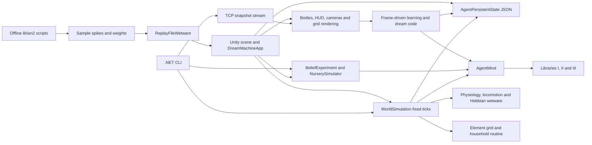

# Project Dreamer architecture audit

Audited November 26, 2026, from `main` at `02fbc84`. The family simulation is merged. The inventory covers the tracked source, scenes, assets, build configuration, test projects, and sidecar. [Benchmarks and verification](PERFORMANCE_BENCHMARKS.md) record the configurations that were executed.

Both .NET projects compile the exact C# sources in [`Core`](../Assets/DreamMachine/Core/). Unity compiles those files with an assembly definition that prohibits UnityEngine references. Unity Edit Mode and the .NET runner also share the test sources. Unity, the CLI, and the Python sidecar have separate entry points.

## Inventory and gaps

| Directive area | Existing implementation | Gap or limitation |
| --- | --- | --- |
| World and time (§14, §21) | `WorldSimulation` runs full 0.05 s ticks. `TimeGovernor` plans whole ticks. Phone/Laptop/Beefy select 12/16/24-cell grid widths. `ElementGrid` updates heat, combustion, water, ice, steam, and smoke. Seeded household routines coordinate two parents and two learners. `CreateBalanced(3)` configures six learners and six mentors. | The Unity app retains frame-driven state writes. Quality presets have no neural fidelity knobs. The “larger cast” benchmark exercises six learners but the household kernel still generates two shared parent pose buffers. |
| Libraries and cognition (§7, §11–12) | `AgentMind` combines a statistical prior, seed-dependent possibilities, and evidence-based belief revisions. `AppendixEntry` stores source, time, evidence, and old/new statements and confidence. `LlmLibraryOneHook` exposes an optional transport. | Higher reasoning and hemispheric integration are research concepts. Provenance uses strings and mixed time units. No general event graph, contradiction agenda, dedicated episodic index, or complete append-only research ledger. The bounded visual observation cache is transient and has a different purpose from Library III. |
| Curiosity (§9) | `EmotionState.Curiosity` modulates exploration and learning rate. The walker babbles and practices. | The kernel schedules object trials by tick and seed, and the Unity frame path selects a nearby prop. No learner-owned question, learned interest, action-specific learning progress, independent safety gate, or noise control. |
| Development, senses and motor (§10, §14–17) | `PopulationConfig`, `SeededRandom`, `WalkLearner`, `PoseMapper`, and `MuscleMemoryLibrary` support seeded characters, a sagittal walking model, observed pose mapping, and motor retention. `PhysiologyState` models stretch, withdrawal, conduction delay, muscles, energy, hormones, heart, and breath. Kernel perception samples local heat and smoke. Unity has RGB and ID-mask cameras and projects selected observations into scene coordinates. | The rig is a segmented renderer. Growth uses age scaling. No per-bone growth, joint-based carrying, capability gates, stance/touch learning with force, bilateral hearing, articulation, teacher-guided manipulation, or transfer tasks. Kernel examples still receive scheduled object identities and call hidden-rule outcomes. Unity ID masks and world-position lookup provide privileged information and need experimental labels. |
| Neural computation and bridge (§5–8) | `IWetware` has Hebbian, toy leaky integrate-and-fire, and CSV replay implementations. The household uses a four-input, three-output Hebbian learner per child. Brian2 generates sample STDP outputs offline. Unity loads the replay to count rows. `IPeerChannel` has an in-process implementation. | No topology importer, recurrent functional population architecture, live Brian2 integration, individual sparse neural plasticity, or bidirectional hemispheric protocol. `IPeerChannel` is an inter-agent seam, with separate responsibilities from a hemisphere bridge. |
| Dreaming and imagination (§13, §18) | The kernel writes a `dream:` hypothesis and rehearses a pose at night. `NurserySimulator` and Unity can restage observed props with `DreamRecombinator`, and the Unity dream stage draws them. | No structured, versioned scene graph or causal replay queue. Dreams lack a link to a specific waking trial and a next-day test. The frame path can skip phase boundaries when a batch spans them. |
| Identity, persistence and social learning (§10, §19, §22) | Role IDs and birth seeds, JSON learner export/import, partial physiology, walker, affect, beliefs, and recent observations. Social attention weights parent/sibling and mentor poses. | No complete world, neural, relationship, or random-state checkpoint. `Start` replaces freshly loaded actor state with new kernel state; `ResetBabies` rebinds the view actors separately from the kernel. There are no experimental mentor–squire groups with reciprocal guidance or teacher controls. |
| Observatory and science (§20, §23–24) | The HUD shows real mood, camera, beliefs, heart rate, and achieved-time data. The CLI and batch entry run a seeded A/B/C belief-amendment experiment. Sample CSVs cover trial outcomes, growth and physiology. TCP 4077 streams a small viewer snapshot. | No 3D observatory, historical activity inspection, independent causal log, developmental assessments, or curiosity/replay/bridge ablations. The TCP stream and sample CSVs lack a versioned telemetry contract. |

## Unity assets and dependencies

- `DreamMachine.unity` serializes a camera and light. `DreamMachineApp.AutoBoot` builds the family, ground, props, house, HUD, cameras, element markers and dream display at runtime. Its bootstrap currently applies after any initial scene in an interactive player. `SampleScene.unity` is the URP template scene and is also enabled in Editor Build Settings. The repo has zero tracked prefabs.
- `CharacterFactory` creates primitive body segments, hair and clothing. `MobileHud` builds uGUI. `DreamInput` and the input-system UI module process interaction. `GridColorJob` uses Burst for overlay colors. The two custom shaders render color and ID masks. `Resources` contains the family, appearance, and Brian2 replay data. `Assets/Settings` holds mobile/desktop URP and renderer assets. `TutorialInfo` is template documentation/editor tooling.
- `BatchExperiment` invokes the headless research path in Unity. `BuildScript` and the workflow-dispatch GameCI job build an ARM64 IL2CPP APK. The package manifest, lockfile, project settings, and generated solution set editor and mobile dependencies. See [dependency and licensing assessment](RESEARCH_INTEGRATION.md#current-dependencies).

## Conflicts to resolve before new architecture

1. **Competing state owners.** `Start` shares each kernel child's mind, state and wetware with its Unity actor. `StepBaby`, `EncounterNearest`, `BeginNight`, and camera captures still mutate parts of that shared state. Remote mode also runs `StepActors`. Separately, `NurserySimulator` is an older experimental harness. Treat its results as a named fixture. The household should converge on one authoritative mutation path while preserving the behaviors that are actually demonstrated.
2. **Restore and replay coverage.** Loading an actor and then replacing its state, as well as zero/partial timestamps and a partial `StateHash`, makes exact resume and full-state comparisons unproven. Add compatibility tests for existing JSON before migrating saves. Check day/night event order across tick batches and render cadences.
3. **Observation boundary.** Separate environmental truth, learner observations, scripted teacher demonstrations, and post-action outcomes. The child may observe a pose or sensory effect and infer from it. Absolute prop positions and hidden rules belong to environment/evaluation code unless a sensor explicitly supplies equivalent information.
4. **Performance candidates.** `ElementGrid.Step` scans the grid each tick. Pose generation, physiology, and wetware run every tick. Walking rollouts and reinstantiating the object pool and rule world are periodic allocation candidates. Synchronous camera readback, render-side learning, and UI refresh need editor/Android profiler captures. These are code-inspection findings pending attribution with a profiler. The batch timer defect was reproduced and fixed in this change.
