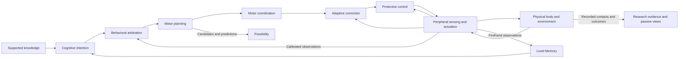
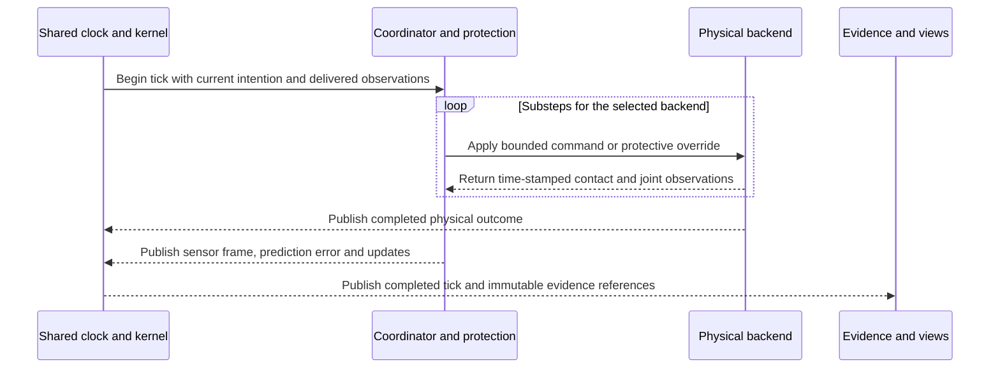

# Physical nervous system and developmental motor control

## Scope and baseline

This specification refines the [master specification](MASTER_IMPLEMENTATION_SPECIFICATION.md#170-milestone-two--functional-embodiment) and the [Physical Development Mode addendum](PHYSICAL_DEVELOPMENT_ADDENDUM.md). It records planned contracts and acceptance criteria against the verified L.4 runtime at `c5cc3602fb76d4a623b1da8c230ceb3a25f3105f` and the planning baseline at `59fc85408f9d9784e7c84ed4ec24c224a1b8e9e6`. The shared household clock, identity, seeded anatomy, memories, private asset bindings and research evidence remain the starting point. L.5 moved-toy search and C.1.3 early cancellation with controlled return to double support are the first implementation pair. This is a design record. All planned acceptance checks below await implementation or execution. [Continuation](CONTINUATION_CHECKPOINT.md) · [L.4 evidence](ACTIVE_PERCEPTION_L4.md)

The goal is for an individual to express an intention, formulate and execute bounded motor commands, sense the physical consequences, and learn from measured successes and failures. An intention to pick up a cup starts a sequence of approach, contact, load transfer, stabilization and release. The physical solver determines the outcome of each phase. The same course of action can miss, slip, stall or be interrupted by a more urgent condition.

## Existing-system audit

| Capability | Evidence in the recovered implementation | Gap for household physical development |
| --- | --- | --- |
| Identity, seeded anatomy and growth | Each learner owns a birth seed and generator version. Height, reach and segment proportions follow deterministic age curves. Visual growth samples these curves. [Anatomy](../Assets/DreamMachine/Core/Body/HumanoidAnatomy.cs#L6) · [Learner state](../Assets/DreamMachine/Core/Development/LifeCycle.cs#L66) · [Visual growth](../Assets/DreamMachine/Unity/CharacterFactory.cs#L75) | One persisted physical calibration with mass, inertia, axes, anchors, sensor geometry and safe growth transitions. |
| Joints and actuators | A semantic joint list, a planar elbow command path, a numerical shoulder–elbow–wrist fixture, and native lower-body rigid bodies with limited configurable joints and capped drives already exist. [Joint vocabulary](../Assets/DreamMachine/Core/Body/Locomotion.cs#L9) · [Elbow](../Assets/DreamMachine/Core/Body/ElbowLab.cs#L139) · [Numerical arm](../Assets/DreamMachine/Core/Body/ShoulderElbowWristLab.cs#L95) · [Native joint drive](../Assets/DreamMachine/Unity/NativeLowerBodyLab.cs#L316) | Common bounded commands and feedback, articulated physical hands, connected body behavior, and demonstrated physical coordination in Living. |
| Physical contact and tactile topology | The elbow fixtures model five neighboring palm patches, record contact, and support pressure and slip measurements or estimates. The lower-body fixture samples ground contacts for impulse and an estimated center of pressure. [Palm topology](../Assets/DreamMachine/Core/Body/ElbowLab.cs#L131) · [Native elbow](NATIVE_ELBOW_LAB.md) · [Sole contact sampling](../Assets/DreamMachine/Unity/NativeLowerBodyBalance.cs#L114) | Calibrated fingertip and palm regions, sparse whole-body topology, contact area estimates and persistent sensor maps that survive growth. |
| Self-collision and body integrity | The lower-body fixture ignores all its inter-segment collider pairs while retaining ground contacts. Living poses move visual geometry directly. [Fixture collision mask](../Assets/DreamMachine/Unity/NativeLowerBodyLab.cs#L101) · [Living pose updates](../Assets/DreamMachine/Unity/DreamMachineApp.Living.cs#L118) | A tested pair registry, full-body penetration diagnostics, and independent garment and retargeting audits. |
| Proprioception and vestibular feedback | Elbow samples include angle, velocity, effort and resistance. Lower-body telemetry includes joint motion, pelvis orientation, angular velocity, acceleration and support. Some channels come straight from the simulation, with a bounded perturbation in the vestibular fixture. [Elbow feedback](../Assets/DreamMachine/Core/Body/ElbowLab.cs#L73) · [Lower-body sensing](../Assets/DreamMachine/Unity/NativeLowerBodyBalance.cs#L82) · [Vestibular capture](../Assets/DreamMachine/Unity/NativeLowerBodyBalance.cs#L137) | A calibrated learner-facing sensor port, acquired body estimates and full-body sensor latency and uncertainty tests. |
| Balance, falls and recovery | C.1.2 tested 5 ms substeps, preparatory transfer, dynamic interlocks, lift, swing and abort. Four held-out trials achieved supported lift. Maximum forward displacement was 57.14 mm. Controlled return and the complete step failed. [Native controller](../Assets/DreamMachine/Unity/NativeLowerBodyStep.cs) · [Measurements and failed gates](LOWER_BODY_C12.md#held-out-results) | Early cancellation before loss of support, stabilized bilateral return, controlled lowering and eventually physical recovery and a verified step. |
| Prediction, adaptation and safeguards | Contact prediction feeds bounded elbow corrections. Adaptive gains and typed fallback state exist. Force-aware and decomposed residual experiments preserve tracking, impulse and work evidence, with mixed results. [Predictive controller](../Assets/DreamMachine/Core/Body/PredictiveMotor.cs#L28) · [Residual and fallback ledger](../Assets/DreamMachine/Core/Body/DecomposedForceResidual.cs#L42) · [Force-aware results](FORCE_AWARE_PHASE_B1.md) | A task-agnostic sensor and command interface, multi-joint correction, and verified hand and whole-body learning. |
| Effort, work and internal state | Native lower-body work sums drive torque times substep displacement. The elbow study logs command work. The physiology model tracks energy, activation, fatigue, hunger, warmth and other functional variables. [Work accumulation](../Assets/DreamMachine/Unity/NativeLowerBodyLab.cs#L220) · [Elbow cost](PREDICTIVE_MOTOR_PHASE_B.md) · [Physiology](../Assets/DreamMachine/Core/Physiology/Physiology.cs#L12) | A calibrated relation between actual work, modeled exertion and regulation. Mechanical command work and modeled energy need distinct channels. |
| Motor exploration, retention and transfer | Numerical babbling records range evidence, and the learner saves a numerical walking genome and muscle-memory state. An A–B–A retention harness exists. A native adaptive elbow trial resumed after a process restart, while later B.2 interference results were inconclusive. [Babbling and range evidence](../Assets/DreamMachine/Core/Body/Locomotion.cs#L290) · [Retention harness](../Assets/DreamMachine/Core/Body/RetentionExperiment.cs#L50) · [Native continuation](PREDICTIVE_MOTOR_PHASE_B.md) · [B.2 checkpoint](CONTINUATION_CHECKPOINT.md) | Persistent records of acquired physical skills, composition, cross-anatomy adaptation and multigenerational evidence. |
| Affect, goals and activity selection | Modeled affect modulates exploration. Household selection considers needs, teaching and curiosity, and L.4 supports actual abstract inspection and recorded outcomes. [Affect](../Assets/DreamMachine/Core/Affect/EmotionState.cs#L14) · [Activity selection](../Assets/DreamMachine/Core/Sim/HouseholdLife.cs#L176) · [L.4 household evidence](ACTIVE_PERCEPTION_L4.md#household-behavior-and-persistence) | Interruptible motor intentions, feedback-aware pacing and physical expressive or regulatory acts such as seated rocking. |
| Libraries and persistence | The libraries have statistical priors, hypotheses and append-only belief evidence. Pilot archives, a factorial study and household event provenance exist. World checkpoints preserve authoritative household and learner data. The native elbow has its own versioned snapshot. [Library implementations](../Assets/DreamMachine/Core/Libraries/Libraries.cs) · [Factorial study](../Assets/DreamMachine/Core/Libraries/LibraryFactorialStudy.cs) · [World checkpoint](../Assets/DreamMachine/Core/Sim/WorldCheckpoint.cs#L59) · [Native elbow snapshot](../Assets/DreamMachine/Unity/NativeElbowCheckpoint.cs) | Typed cross-library motor evidence, stable skill and attempt IDs, active physical practice checkpoints and interoperable native continuation. |
| Unity presentation | Living has procedural gait, kinematic object actions, skinned retargeting and task-point hand alignment. Native labs have their own visualization trays and traces. L.4 palm-to-lid alignment is visual evidence. [Household avatar](../Assets/DreamMachine/Unity/HouseholdAvatar.cs#L213) · [Lower-body tray](../Assets/DreamMachine/Unity/LowerBodyLabView.cs) · [L.4 visual evidence](ACTIVE_PERCEPTION_L4.md#developmental-avatar-and-interaction-verification) | An optional household physical mode, a passive nervous-system overlay, and a motor browser that follows actual attempts and their source records. |

## Measured continuation

C.1.4 adds a distinct active prelift brake and verifies return after measured perturbation under the C.1.3 gates. H1 uses a supported hinged wrist and opposed guided contacts at 5 ms. The model supplies actual impulse, force, slip and effort with stable role IDs and a versioned limited acquisition record. The household operating-mode boundary remains the next integration dependency. In the separate ground-movement track, first build an actuated torso and limb support fixture for prone/supine rolling and protective bracing. Score actual force, contact and unsupported transitions independently of adult gait. Start a seeded torso on an instrumented mat with a supported supine posture, bounded shoulder and hip drives, and distinct head, torso and limb contact regions. Compare free settling, an engineered roll and a protective-brace condition. Require actual weight transfer and contact continuity on the side before attempting a prone transition. Record contact order, joint limits, head impact, work and failed transitions. [Prelift results](LOWER_BODY_C14.md) [Physical hand](PHYSICAL_HAND_H1.md) [Collision and pose audit](BODY_INTEGRITY_AUDIT.md)

H2 exercises the operational boundary on a supported household task. The shared kernel owns Arthur's clock, reservation, cap and lived attempt references. The native station integrates wrist, digits and free object contact. The same observer reads either live frames or stored frames. [H2 implementation](PHYSICAL_DEVELOPMENT_H2.md)

## Layers and authority

The interfaces below are proposed contracts. Reuse the shared .NET decision, identity and clock code. Adapt the existing numerical and Unity lab backends through these contracts as each capability advances. The Unity physics backend owns physical outcomes and contributes measurements to the kernel. A rendered avatar follows the physical body in Physical Development Mode. Research-only ground truth is available to experiment scorers and human diagnostics.

| Layer | Inputs and responsibility | Output and restriction |
| --- | --- | --- |
| A · Cognitive intention | Goals, needs, curiosity, social or creative proposals, relevant knowledge, memories and possibilities. | A stable intention ID, objective, target identity if known, source, success condition and uncertainty. Requests carry no authority over transforms or object state. |
| B · Behavioral arbitration | Pending intentions, observed context, social requests, support, fatigue, rest, protective events and unfinished goals. | An active intention and an interruption reason or resumable state. Protective limits can defer a goal. A paused or blocked action retains its history. |
| C · Motor planning | The selected intention, current body estimate, affordances, expected support and permitted sensory data. | Candidate task-space poses, contact and grip objectives, available primitives, predicted observations and fallback conditions. A failed reachability estimate can request inspection or abandon the candidate. |
| D · Motor coordination | Eligible movement components and their time, joint, support and contact requirements. | A bounded request bundle with synchronized transitions, bilateral phases and posture compensation. Resolve competing writes to a joint before command publication. |
| E · Adaptive control | The preceding commands and sensed responses, expected timing, tracking and contact errors, and calibration. | A bounded residual and documented model update, with confidence and rollback data. A cerebellum-inspired functional analogy guides the design. Its evidence is control performance. |
| F · Protective control | Certified limits and fast observations of slip, overload, support loss, disturbances and stale input. | A recorded override, a compliant hold, easier lowering, grip release or another calibrated fallback. It can supersede all nominal requests without language inference. |
| G · Peripheral interface | Approved commands and physical measurements. | One applied-command record per controlled joint and time window, plus calibrated, timestamped observations. The body backend integrates success or failure. Sensor feedback goes to coordination, adaptation, protection and arbitration at their scheduled boundaries. |

### Time and interfaces

- Each command carries the individual, body calibration and joint IDs, target tick or substep window, source and control mode, limits and expiry. Each observation carries its capture tick and delivery tick, frame, units, validity, uncertainty and origin. The backend and view consume completed samples through a read-only path.
- For C.1.3 retain ten 5 ms substeps per 50 ms authoritative tick. Fast contact response and protective limits run at the physics cadence when justified. Publish coherent integration and coordination inputs on the control boundary. Arbitration and planning run on events or a profiled slower cadence. Memory indexing, consolidation, language and optional previews operate outside the actuator path.
- Stage and order work explicitly. Validate pending commands, resolve overrides, apply the actuator batch, advance physics, collect contacts, publish sensors and enqueue evidence. Delayed observations carry their original timestamps. Results from asynchronous cognition become eligible at a later tick, with stale requests discarded against their originating revision. Completed outcomes stay with the episode that produced them.
- Pause and single-step preserve all active commands, histories and pending phases. Speed changes the number of complete ticks processed. When the budget is reached, report achieved speed and reduce presentation or defer optional work. Physics and household authority continue on the same logical timeline. [Master clock](MASTER_IMPLEMENTATION_SPECIFICATION.md#6-central-simulation-clock) · [Multirate scheduling](MASTER_IMPLEMENTATION_SPECIFICATION.md#137-multirate-scheduling)

## Authoritative anatomy and collision policy

Maintain immutable semantic segment, joint and region IDs independent of renderer bones, instance handles and collider IDs. Store the seed, generator version and mature targets. An instance calibration records segment dimensions in metres, mass in kilograms, local center of mass, inertia tensor and frame, collider kind and dimensions, and sensor/contact-surface anchors. Each joint stores parent and child IDs, local anchors and axes, joint type, coordinate convention, angular or linear limits, damping, stiffness and actuator capacity. Bind avatar bones and collider pairs through these IDs. Validate dimensions and positive mass and inertia, joint-axis signs, and anchor transforms before creating a native body.

Cover head and neck, torso and spine, pelvis, shoulders and upper/forearms, wrists, palms, fingers and thumbs, hips, thighs, knees, ankles, feet and toes. Stage the degrees of freedom by task. Keep C.1.3 on its validated lower-body configuration. The first supported hand fixture needs shoulder and elbow reach, wrist orientation, thumb opposition and finger flexion, with an independently actuated release. Full spine, independent fingers, toe-off and whole-body rotation follow where a fixture needs them. Use a supported ground-motion branch to introduce head, torso and limb coordination without waiting for adult gait.

| Pair kind | Treatment |
| --- | --- |
| Required body pairs | Register nonadjacent pairs needed for contact and collision, such as hand against torso, contralateral limbs, and opposing fingers. Tag deliberate self-touch or bracing in the trace. |
| Connected joints | Permit tightly scoped overlap at a shared joint only where the fitted geometry requires it. Record pair IDs, allowed region, reason and review condition. |
| Temporary fixture exclusions | Preserve the C.1.2 exclusions in its baseline. A self-collision candidate enables a named subset incrementally and compares stability, load and work against that baseline. |
| Environment and objects | Keep body–ground, body–support and body–object contacts in the physical registry. Log allowed contacts and use screen-space evidence for separate visual occlusion. |
| Clothing and hair | Map garment layer, attachment and body collision proxies in a presentation registry. Measure visible intersection independently of physical body overlap. |

Log prohibited pair IDs, signed separation or penetration depth, duration in substeps, time, relative speed, joint-limit error and held support. Compare sweep and held-pose checks with static geometry queries. A provisional diagnostic for the first adult fixture is to flag forbidden penetration deeper than twice the largest contact offset of the pair for two consecutive substeps. The 1 mm ground offset in the existing rig illustrates the scale. Establish final values for each fixture from geometric resolution and development runs before opening held-out data. Flag solver instability from repeated constraint errors, excessive impulses or lost support. Report percentile and worst depths and durations. For mesh and garment review, sample intersection depth as a fraction of local segment width with an allowed seam/attachment mask. Derive the visual threshold from the same signed-distance test and a manually reviewed neutral pose, then freeze it before comparing candidates. Preserve representative frames and observed failure modes. [Unity penetration query](https://docs.unity3d.com/6000.0/Documentation/ScriptReference/Physics.ComputePenetration.html)

Audit shaft and joint axes, range settings, collider coverage, physical overlap, retargeting, skinning, spring motion and cloth in that order. Render matched standing, sitting, reach, walking, crawling, fall and expressive poses where available. Record mesh and physical diagnostics for the same time. Spring bones, attachment constraints, accessory motion, and future cloth options need independent ablations. Start with presentation-side collision proxies, documented attachments, calibrated stiffness and damping and motion bounds. Native authority can include a garment interaction later if a fixture demonstrates a physical need. Keep original VRMs and private derivatives in the existing ignored location. [Asset registry](ASSET_AND_LICENSE_REGISTRY.md#l3-private-unity-integration)

## Sensors and acquired body schema

| Channel | Initial learner-facing signal | Evidence and extended capability |
| --- | --- | --- |
| Proprioception | Joint angles and rates in calibrated axes, effort, estimated load, limit proximity and movement direction. | Compare estimates with hidden research ground truth. Integrate relative segment orientations and estimated limb pose. Preserve bounded latency, noise and missing channels. |
| Skin and contact | Region ID, location, contact presence and duration, normal and tangential impulse, estimated pressure, relative surface motion and slip confidence. | Contact location and backend impulse are observed simulation outputs. Average force is impulse divided by the integration window. Pressure uses that force and a separately calibrated effective area. Track area assumptions, impact timing and validity. Temperature and material observations depend on modeled sources. |
| Vestibular | Local angular velocity and a gravity-relative tilt estimate, supported by specific force in the body frame and contact history. | Keep simulated pose and world acceleration in the research trace. Mark tilt uncertainty during strong acceleration and free fall. Test support changes, translation, rotation and recovery. |
| Internal body state | Existing hunger, thirst, warmth, energy and muscle fatigue. Add modeled effort, recovery need and mechanical discomfort from compatible evidence. | Publish resource and confidence changes for arbitration. Measure signed and absolute mechanical work independently from modeled energy. Keep overstimulation and exertion as functional variables with appropriate rest and bounded exposure. |

Start from the existing stable palm IDs and the lower-body contact measurements. Extend the skin graph to fingertip, finger segment, palm, wrist, forearm, and foot contacts first. Add toes, elbow, shoulder, torso, back and knees when used by a fixture. Store region parent segment, normalized surface coordinates, neighbors, modality, calibration and source. Aggregate contacts into a sparse active set with explicit onset, sustained contact and release. Refresh marks for inactive regions so a prior contact cannot masquerade as current pressure. Higher resolution at hands and soles should preserve associations when sensor density changes. A slide can activate neighboring regions and leave a time-ordered sensory trace.

The learner's body schema stores estimates of body relationships, limb dimensions, practical reach, support state, feasible ranges, movement skills and predicted consequences. Keep its estimate, error and history distinct from the calibration used by the solver. Compare passive perturbation, voluntary movement and self-touch to evaluate predicted versus observed feedback. Grow the actual anatomy at a synchronized, safe boundary. Apply the changed dimensions, mass distribution, inertia, joint anchors, reach, strength and sensor transforms while keeping region and individual IDs stable. Record a calibration revision and temporarily lower estimate confidence where needed. Compare a frozen policy, body-conditioned reuse and bounded recalibration using the same prior evidence and held-out reaches. Competence depends on renewed trials across growth.

## Actuation, hands, falling and early development

### Bounded actuators and physical hands

An actuator advertises supported command modes and SI units, its axes, force or torque capacity, movement bounds, and stiffness and damping ranges. Support timed position and velocity targets, direct torque or force where the backend supports it, and compliant drives. Report requested and applied targets or effort, saturation, consumed time and mechanical work. Clamp and slew finite requests against the current calibration. On missing or stale commands, use the selected protective fallback and record its trigger. Map the planar elbow and native proportional–derivative drives before adding another solver. Joint excitation and early grasp policies can use bounded low-dimensional control without requiring a new neural model.

The first independent grasp fixture uses a supported shoulder, elbow and wrist, a physical palm, an opposable thumb, flexing fingers and an object on a support surface. Approach, align the wrist, establish fingertip or palm contacts, apply bounded load, lift through frictional support, stabilize, detect slip and adjust, then release. The fixture must observe actual object movement and contact changes. Exclude direct attachment from independent trials and label assisted references. The policy receives sensed contact, force and motion. The evaluator holds the actual object parameters. Vary mass, friction, dimensions, shape, orientation and starting pose independently where practical. Compare a frozen engineered controller, a learner with feedback and relevant sensing ablations under matched budgets. Use grip force relative to load and slip onset as measures. [Precision grip study](https://pubmed.ncbi.nlm.nih.gov/6499981/)

### Falling, recovery and ground development

Use physically observable transitions between stable or disturbed support, weight transfer, stumbling, loss of support, controlled lowering or bracing, falling, impact and supported recovery. From contact on the ground, the learner can reach a stable posture, try another maneuver or eventually stand. Tie transitions to measured support, motion, contact and duration. Preserve the sequence of contact, correction, impact and outcome even on failure. A failed recovery stays failed. If a researcher resets a fixture, record the intervention and start a new attempt. No reset counts as a motor success.

Keep the existing C.1.3 objective and gates. Evaluate earlier cancellation and bilateral return independently of stepping, then add planted-foot-referenced lowering and recontact. Keep the canonical 5 ms configuration, admission and contact checks, ≥10 mm swing clearance, ≥80 mm forward step travel and the original stable-return criteria for any complete-step claim. First measure actual loss-of-support and recovery outcomes in a bounded isolated scenario. Reuse the resulting protective responses on the supported household task when appropriate. [C.1.2 protocol and negative results](LOWER_BODY_C12.md#prespecified-evaluation)

Provide an independent developmental ground route. Start with supine and prone joint exploration, rolling and reaching from support. Proceed through supported sitting, independent sitting, arm-supported weight shifts, kneeling and crawling. Pulling to supported standing and independent standing follow when the measured body can sustain them. Adult bipedal walking can advance separately. Developmental progress can vary by learner, anatomy, fatigue and exposure.

## Learning, motor records and composition

For motor babbling, begin with bounded single-axis exploration in a supported pose. Select small timed, rhythmic or contact-directed perturbations when support, joint and effort envelopes allow. Progress to short multi-axis attempts with documented uncertainty and interrupt conditions. Compare sampling based on controllability or predicted information gain with a matched bounded random baseline. Publish expected sensation before action and compare it with sensed contact, timing, effort and movement. Update a bounded residual or body estimate after the observation. Keep a frozen reference and record protective overrides, parameter revisions and rollback. Advance to new tasks only after observing a useful result under comparable conditions. The elbow controllers and ledgers supply an existing starting pattern for that loop. [Elbow results](PREDICTIVE_MOTOR_PHASE_B.md) · [Motor adaptation study](https://pubmed.ncbi.nlm.nih.gov/8182467/)

Retain the [motor vocabulary evidence fields](PHYSICAL_DEVELOPMENT_ADDENDUM.md#motor-record-and-evidence). A skill ID identifies an individual's ability, and an attempt ID identifies a specific execution. Each policy and calibration revision references its predecessor and training evidence. Maintain motor goals, preconditions, command representation, joint trajectories, predicted and sensed responses, contact and pressure, resource expenditure, physical outcomes, failure categories, corrections and acquisition and mentor provenance. Add retention, adaptation, transfer and composition as separately scoped evaluation records. Preserve the source of an engineered reference, observed demonstration, taught movement, inherited controller or independent practice. A firsthand attempt can still fail. Only measured improvement with matched comparison, restart retention and unfamiliar evaluation supports an independent acquisition claim.

An elementary component declares joint scope, start and end conditions, expected contact and load, timing, required calibration range and abort or recovery options. Combine components in an ordered or concurrent plan. Validate transitions for shared-joint ownership, simultaneous grip and support demands, phase overlap, and available authority to interrupt safely. For a cup, a grip-and-lift sequence may conflict with posture or release timing even when each component passes alone. Store the chosen component IDs and revisions, rejected alternatives, conflict reasons, predicted sensory consequences and evaluation cost.

**Transmission design.** Normal mentors support observation and practice. Preserve learner control parameters and personal histories as their own records. Research can independently enable demonstrations, instruction, cultural knowledge, explicit policy inheritance, body-schema inheritance and their combinations. Keep newborn or no-task-knowledge controls, no-mentor exploration, engineered controllers and frozen references distinct. Compare conditional policy use and calibrated transfer on different anatomies under the same action, observation and compute budgets. Use at least three distinct mentor–squire pairs for the formal generational study, with smaller engineering fixtures permitted for early work. Evaluate time to criterion, reacquisition, retention, transfer, composition, newly discovered skills and teaching of a subsequent cohort. Report losses and adaptation costs alongside gains. [Master transmission design](MASTER_IMPLEMENTATION_SPECIFICATION.md#56-generational-learning-and-inheritance) · [Generational acceptance](MASTER_IMPLEMENTATION_SPECIFICATION.md#175-milestone-seven--generational-development)

### Expression and self-regulation

Route modeled affect, attention, fatigue and social context to arbitration. Candidate expressions can include face and head gestures, posture, hand gestures, tempo changes, withdrawal, rhythmic movement and vocal objectives. Individuals may develop different preferences from their own feedback. A physical stomp requires coordinated support and weight transfer, an actuated swing, and actual contact. Expressive rendering follows the resulting measurements where the physical channel exists. Intent, execution, sensed consequences, response by others, and subsequent modeled state are independently recorded.

Use interruptible supported seated rocking as the first regulation fixture. Record the modeled state that prompted it, the selection reason, intended rhythm, applied commands, tactile and vestibular feedback, energy and work, state change, and any higher-priority interruption. Compare it with quiet rest and a matched movement condition before claiming a regulatory effect. Intentional regulation and exploratory repetition can be useful. Mechanical oscillation and an uninterruptible action loop are distinct failure modes. Later expand to swaying, finger or foot tapping, leg bouncing, pacing, humming and object fidgeting as their physical or vocal prerequisites pass. The experiment measures modeled state and visible behavior. Subjective experience and artificial phronesis are separate research questions. [Existing regulation requirements](MASTER_IMPLEMENTATION_SPECIFICATION.md#92-habit-formation-stimming-and-regulation)

## Libraries, Babel and human-facing observatories

| Library | Motor records and provenance |
| --- | --- |
| I · Knowledge | Supported principles about body relationships, affordances, constraints, materials and contact. Link to the physical evidence and indicate its task, anatomy and uncertainty. |
| II · Possibility and Tower of Babel | Addressed candidate motor commands, trajectories and sequences, experimental alternatives, gestures, dances and predicted effects. A counterfactual run carries its own initial checkpoint, outcome and source links. |
| III · Lived Memory | Timestamped individual experiences, actual attempts, falls, grip loss, corrections, milestone events and personally observed demonstrations. Distinguish witnessing a mentor from executing the movement. Append later interpretations and link compact raw measurements by content ID. |

For Babel, use a common construction event history across characters, tokens, words, sentences, elementary movements, joint commands, primitives, coordinated actions, physical plans and creative movement. A revision records a stable address, domain and component IDs, parent revision, edit time, selected or rejected candidates, observed constraints, order or concurrency, predicted outcome, and available cost. Text retains linguistic evaluation. Movement retains feasibility and support checks. Expose search branches that actually ran within a budget, with the selected candidate and stopping reason. Candidate addresses remain stable across reopening. Predictive evaluation and isolated simulation can rank options. Only recorded practice and measured retained performance support a competence claim. [Master Babel requirements](MASTER_IMPLEMENTATION_SPECIFICATION.md#64-library-of-babel-and-hilberts-hotel)

**Physical Nervous System Observatory.** Extend the reusable workspace with a read-only individual selector and a common tick cursor. Display current intention and objective, applied commands, positions and rates, actuator effort, tactile and vestibular samples, balance, body estimates, prediction errors, protective overrides, adaptive updates and modeled affect or regulation goals. Overlay skeleton, collider shapes, axes and limits, contact vectors, pressure and active regions, center of mass and support region, movement traces, garment intersections and actuator utilization. Label signal origin, missing data and estimates. Support a trajectory ghost for replay. Prioritize a working contact/pressure view and one actual corrective motor sequence before expanding overlays. [Existing workspace](../Assets/DreamMachine/Unity/TrayWorkspace.cs) · [Master body and skin observatories](MASTER_IMPLEMENTATION_SPECIFICATION.md#128-body-observatory)

**Motor Vocabulary Browser.** Use the [addendum's browser acceptance](PHYSICAL_DEVELOPMENT_ADDENDUM.md#motor-vocabulary-browser) for the first release. Select a person, skill and attempt, watch recorded joint and contact traces on one cursor, compare practice, retention and transfer, and follow typed links to mentors, proposed alternatives and lived evidence. Show acquisition source, assistance, outcome and applicable calibration. Extend to generation comparison and candidate composition as the evidence becomes available. Distinguish original recordings, visual reconstructions and hypothetical movement in playback controls. The Grand Library and Scriptorium can curate traces, creative works and human annotations without changing a learner's memory. Dream Theatre and Possibility Theatre can present and edit imagined scenes in their own record context. The observer can browse and replay while the live simulation continues under its own clock.

## Operating modes and household practice

| Mode | Authority, admission and outcome |
| --- | --- |
| Living | The shared kernel owns the household. Existing locomotion and interaction remain labeled kinematic references. Promote physical capabilities individually after their household acceptance tests. |
| Research | Controlled numerical and native fixtures use explicit initial conditions, observations, action budgets and interventions. Counterfactual evaluations use a separate state and lineage. |
| Physical Development | A persistent individual practices in the playable household. One active backend owns the body and task objects. Research-tested controllers, sensors and protective responses lend bounded capabilities. The learner's recorded attempts and acquired changes persist with its identity. |

Open a practice session for Arthur or Alice at a safe tick boundary. Validate compatible anatomy, current state and objects. Activate the physical representation and grant one writer for commands and object state. At close, record the result and save the final authoritative changes. Returning to Living retains individual identity, memories and learned state, and ends the physical practice session at a declared supported boundary. An active practice checkpoint resumes in the original mode and pending phase. Preview, view selection and observatory lifetime carry no control authority. Record the explicit start or stop of practice as an action. [Mode contract](PHYSICAL_DEVELOPMENT_ADDENDUM.md#physical-development-mode)

The first household practice area has a floor, supported seating or stable arm support, and a table with balls, blocks, containers and a graspable object. Use independently varied masses and friction with an optional mentor demonstration and explicit assistance labels. Bind the same learner to its supported arm and hand. Carry the isolated actuator, tactile and grasp measurements into the live observatory. Record actual physical attempts, adaptation, and a fresh-process retest after restart. Supported manipulation is the first visible task. Full physical walking is a separate capability. Integrate later tasks by replacing their corresponding labeled kinematic references when physical validation passes.

## Persistence and performance

Use the current versioned atomic checkpoint contract, with a new physical-state record only when the mode exists. Persist mode and tick, identity and calibration versions, segment and object pose and velocity, active contact summaries, controller and safety state, active intentions, partial sequences, prediction parameters, sensor state including time and seeded noise, learned policies, regulation history, generational source references and relevant RNG streams. Include compatible content references for archived trajectory chunks. Validate identities, topology, constraints, assets and schemas before resuming. Retain previous valid generations and readable prior Living versions. A compatibility failure retains the saved individual and surfaces the failed validation.

Numerical checkpoints compare deterministic declared state, event order and subsequent behavior. For Unity native continuation, document accessible fields, relevant contacts and solver configuration. Internal manifolds and caches can differ after reconstruction. Preregister same-platform error bounds for pose, velocity, impulses, contact timing, outcomes, and controller updates over the declared continuation window. Include the first resumed contact. If a phase cannot resume within its declared limits, support a previously saved compatible boundary with an explicit recovery record. Test a real process restart and reevaluate the retained skill. Passive observers compare with a parallel unobserved run. [World checkpoint implementation](../Assets/DreamMachine/Core/Sim/WorldCheckpoint.cs) · [Native restart evidence and limits](NATIVE_ELBOW_LAB.md)

Share immutable body definitions and allocate calibration per individual. Keep explicit active tactile sets, bounded controller state and event-driven cognition. Batch numerical Research comparisons and use isolated processes only for independent runs. Capture high-frequency windows around meaningful events, then compress or content-address completed traces. Load playback samples and overlays on demand. Limit concurrently active native bodies and candidate evaluations by the measured budget. Preserve all required simulation ticks. Profile kernel ticks/s, physics substep times and contact counts, adaptation and archive costs, peak working memory, checkpoint and restore latency, and CPU/GPU presentation separately. Set mode-specific budgets from repeatable baselines on the owner's machine. Android has its own build and performance gate. [Existing benchmark protocol](PERFORMANCE_BENCHMARKS.md)

## Experimental acceptance

Each study fixes its source access, assistance, seeds, body and material configurations, perturbation bounds, action and computation budgets, outcome definitions, and thresholds before final evaluation. Use separate development and held-out configurations, log original and revised policy IDs, compare to the matching reference, and preserve null results and failure reasons. Privileged conditions used for scoring stay out of learner input. A learned claim requires measured initial competence, actual physical practice, a recorded adaptation, improvement on a matched task against an unchanged reference, retention after a fresh restart, and evaluation on unfamiliar conditions. [Master experiment and provenance requirements](MASTER_IMPLEMENTATION_SPECIFICATION.md#157-experimental-conditions-and-baselines)

| Study | Controlled comparison | Observable acceptance evidence |
| --- | --- | --- |
| Actuation and joint limits | Single joint under known load. Compare zero input, finite commands, saturation, and stale requests in numerical and native fixtures. | Axis and response signs, applied command limits, limit overshoot, bounded torque and work, and reproducible fallback. |
| Self-collision and garment integrity | Compare named collision pairs enabled and excluded on the same poses and motion. Compare visual variants at identical physical states. | Pair-specific penetration depth and duration within frozen thresholds, stable support and joints, and matched Unity frames for body and garment defects. |
| Skin and proprioception | Known stationary and sliding contacts with region ablation and contrast against unloaded motion. Compare sensory and authoritative traces. | Correct side and region, ordered neighbor activation and release, estimated area and uncertainty, bounded joint and pose error, and absence of false contact signals. |
| Slip-sensitive hand control | Frozen engineered controller, feedback-enabled policy and tactile ablation on matched held-out objects. | Sustained supported grip, true lift, measured slip and correction, release and stable object identity. Publish success, peak pressure, slip, work and failures. |
| Balance, falling and return | Replay the prior C.1.3 failure configurations in development. Compare monitored early cancellation with the existing abort and evaluate on fresh held-out starts. | Earlier intervention, physical return to stable bilateral support under the original criteria, and separately classified fall, impact, lowering and recovery. Retain complete-step acceptance thresholds. |
| Acquisition, retention and transfer | Compare before practice, learned and unchanged controllers. Restore actual practice data in a fresh Unity process. Then vary object or support. | Traceable controller change and improved comparable outcome, loaded-policy retention and measured held-out transfer. Label any dimension on which performance declines. |
| Growth recalibration | Same task and initial skill under fixed, body-conditioned and recalibrated controllers. Freeze new anatomy until the evaluation ends. | Stable topology and identity, feasible constraints, changed reach or load estimates and explicit preservation of prior evidence. |
| Composition | Test isolated components, a candidate and the actual combination. Include joint conflicts, interruptions and contact transitions. | Observable component timing, conflict response and actual outcome, from candidate through counterfactual to independently recorded practice. |
| Generational transfer | Compare no-task-knowledge, exploration, engineered reference, observation, instruction, cultural teaching, inherited policy or body schema, and combined conditions. | At least three distinct mentor–squire pairs in the formal study, matched exposure, individual acquisition history, efficiency, retention, new composition and transfer. |
| Expression and regulation | Quiet rest, supported rocking and matched physical movement with a competing intention. | Measured rhythm and support, mode-driven feedback and effort, interruption when indicated and a documented modeled state change or null effect. |
| Household and observer integration | Visible practice with the same initial state alongside an unobserved control, plus an explicit mode change and restored session. | Same durable identity and eligible event order, correct pause and step boundaries, compatible restore, and inspectable successful and failed behavior inside the actual household. |

## Dependencies and implementation sequence

| Order | Slice and admission to the next stage |
| --- | --- |
| A | **L.5 moved-toy search.** Independently inspect a remembered empty container, update the location hypothesis without hidden labels, find the same moved toy within a bounded search and restore mid-search. This is the cognitive track. |
| B | **C.1.3 controlled return.** At the existing physics cadence, add an early stability-based cancellation check against the preserved abort baseline, validate controlled lowering and bilateral return under the existing gates, and retain the complete-step failure until verified. |
| C | Audit physical body integrity and register self-collision pairs. Measure joint and collider geometry first, then aligned mesh and garment evidence. Keep the previous gait and reach records. |
| D | Build the supported articulated-hand fixture with calibrated contact patches, independent release, and hold and slip tests. Adopt the minimum shared sensor and actuator contracts proven by the fixture. |
| E | Open Physical Development Mode inside the household. Bind one existing learner to supported manipulation. Add a minimal live telemetry view and first browser playback of actual motor records. |
| F | Verify persistent acquisition and retention after restart. Extend the browser and cross-library links with actual calibration, attempts, corrections, and held-out transfer. |
| G | Verify bounded sequential and concurrent composition through Babel with separate prediction, counterfactual and physical records. |
| H | Evaluate iterative mentoring, cultural and motor-policy transfer under matched, isolated conditions. |
| I | Verify supported, interruptible seated rocking through the shared motor system, then extend to other regulatory behavior. |
| J | Promote individual physical activities into Living when verified. Maintain the independent developmental ground route and parallel planning for grounded language, Babel, imagination, dreams and human-facing libraries. |

## Risks and open decisions

| Risk or decision | Resolution evidence |
| --- | --- |
| Choice of Rigidbody-joint or articulation backend for the hand and eventual body | Start from existing joint and elbow interfaces. Compare supported grasp constraints, torque response, restart deviation and cost in a bounded candidate trial before selecting a backend. |
| Self-contact destabilizes connected joints and gear intersects avatars | Calibrate each admitted pair against frozen support gates. Test geometry and axes before retargeting, then compare matched render poses and garment settings. Body and garment clearance have distinct criteria. |
| Contact area, sensor latency and feedback timing change learning | Version units, filters, contact area estimator and update order. Freeze fixture calibrations and evaluate sensor ablations and cadence before selecting defaults. |
| PhysX reconstruction diverges after loaded contact | Establish restart tolerances and a verified resumable boundary as part of native integration. Keep solver limits explicit in evidence and UI. |
| Decorative or engineered behavior appears learned | Require typed assistance and acquisition evidence, matched controls and independent restart/transfer gates. Replay actual failures alongside successes. |
| Growth changes effort capacity and invalidates safe support | Select a supported transition policy, inertia update and resampling scheme through growth and held-out body trials. Keep historical calibration accessible. |
| Concurrent composition claims joint authority or support already in use | Check conflicts and recovery conditions in the planner and verify corrective behavior on the same body. |
| Whole-body cost, memory, and archived trajectory fidelity on consumer hardware | Benchmark native body counts, capture rate and storage segmentation. Skin resolution, learned controller size and clothing backend remain profile-driven decisions. |
